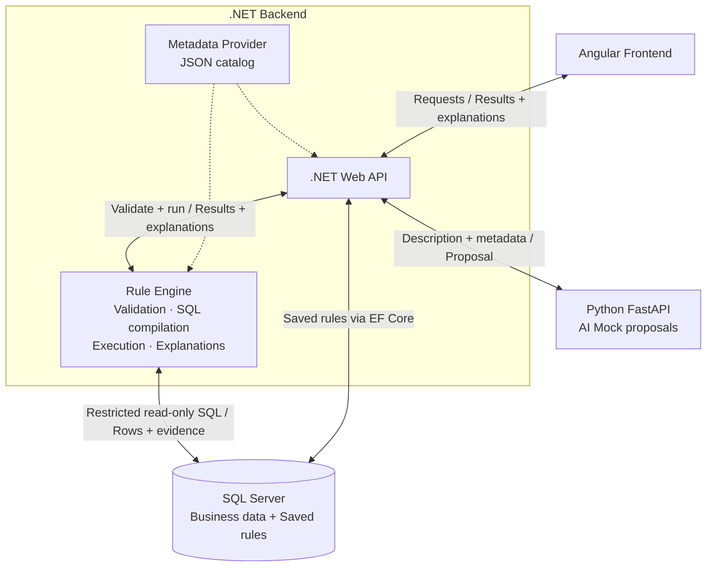

# ‏ארכיטקטורת המערכת

‏המסמך מתאר את רכיבי המערכת ואת מסלול הבקרה מהגדרה ועד תוצאה. להקמה ולהדגמה ראו [README](../README.md); לנימוקי הבחירות ולגבולות המימוש ראו [החלטות ומגבלות](DESIGN_AND_LIMITATIONS.md).

## ‏רכיבים ותקשורת

| ‏רכיב             | ‏אחריות                                     | ‏קוד מרכזי                              |
| ----------------- | ------------------------------------------- | --------------------------------------- |
| ‏Angular          | ‏מסכים, טיוטות, אישור AI ותוצאות            | ‏`frontend/src/app`                     |
| ‏‎.NET Web API    | ‏בקשות HTTP, אימות, שמירה ותיאום הרצה       | ‏`backend/DataControls.Api/Controllers` |
| ‏מנוע הבקרות      | ‏אימות הגדרה, יצירת SQL, ביצוע והסברי חריגה | ‏`backend/DataControls.Api/Rules`       |
| ‏קטלוג המטא־דאטה  | ‏שמות עסקיים, טיפוסים, קשרים ומיפויי SQL    | ‏`backend/DataControls.Api/Metadata`    |
| ‏SQL Server       | ‏נתוני עובדים ומחלקות והגדרות בקרות         | ‏`database`                             |
| ‏Python / FastAPI | ‏הצעת בקרה באמצעות Mock                     | ‏`python-ai`                            |

‏Angular שולח בקשות ל־‎.NET בלבד. השרת פונה ל־SQL Server לשמירה ולהרצה, ול־Python לקבלת הצעות. Python מקבל מטא־דאטה עסקי ואינו ניגש ל־DB.

## ‏ה־DB וקטלוג הנתונים

‏ה־DB לדוגמה מכיל טבלאות `Employees` ו־`Departments`, עם קשר מעובד למחלקה. טבלת `Rules` שומרת הגדרות בקרות. המיגרציות וסקריפטי ההקמה מתארים את מבנה הדאטה בייס; סקריפטים נפרדים טוענים נתוני דוגמה ומגדירים הרשאות קריאה.

‏`AppDbContext` מגדיר את מיפויי EF Core. ‏`RuleService` משתמש בו לניהול הבקרות השמורות. הרצת הבקרות אינה משתמשת ב־LINQ ליצירת השאילתה: `RuleSqlCompiler` יוצר SQL ו־`RuleExecutor` מבצע אותו באמצעות SqlClient.

‏`JsonMetadataProvider` טוען את `metadata.json` פעם אחת דרך `IMetadataProvider`. כל שדה כולל מזהה עסקי, שם להצגה, טיפוס ומיפוי פיזי. הקטלוג מגדיר גם קשרים ועמודות תוצאה קשורות באמצעות `relatedColumns`. מבנה הקטלוג והתאמתו לטבלאות, לעמודות ולמפתחות נבדקים לפני קבלת בקשות.

‏Angular ו־Python מקבלים `MetadataResponse` ללא מיפויי SQL. הוספת שדה או קשר מהסוג הנתמך אינה דורשת לוגיקת בקרה ייעודית, אך המבנה חייב להתקיים ב־DB ויש להגדיר הרשאות קריאה מתאימות. שינוי הקטלוג דורש הפעלה מחדש של השרת ורענון הדפדפן. סוג חישוב או קשר חדש דורש הרחבת קוד.

## ‏מבנה הבקרה ואימות

‏`RuleDefinition` מכיל שם, תיאור אופציונלי, `rootEntityId` ועץ תנאים. ישות השורש היא סוג הרשומות שעליו מבצעים את הבדיקה, למשל עובדים. תנאי שמתקיים מסמן רשומה חריגה.

- ‏`kind: group`: קבוצה עם `and` או `or` ורשימת תנאים, שיכולה לכלול קבוצות נוספות.
- ‏`kind: comparison`: שדה ואופרטור. צד ימין הוא קבוע או שדה מאותו טיפוס; בבדיקות `isNull` ו־`isNotNull` אין צד ימין.
- ‏`FieldReference`: מזהה שדה ונתיב קשרים אופציונלי. לדוגמה, מהעובד דרך הקשר למחלקה ועד לשדה הפעילות שלה.

‏`RuleValidator` בודק הפניות לקטלוג, התאמת טיפוסים ואופרטורים, מגבלות אורך ומורכבות, ודוחה השוואת שדה לעצמו. טקסט אינו מומר אוטומטית למספר או לבוליאני. אותו מאמת משמש לשמירה, לקומפילציה ולאימות הצעות AI.

## ‏שמירה וניהול בקרות

1. ‏העורך מחזיק טיוטה נפרדת מההגדרה שנטענה.
2. ‏שמירה שולחת `POST /api/rules` ליצירה או `PUT /api/rules/{id}` לעדכון, עם `RuleDefinition` בגוף הבקשה.
3. ‏`RuleService` מאמת ושומר דרך EF Core. כשל באימות אינו משנה את ה־DB.
4. ‏אחרי הצלחה חוזרים לספרייה; בכישלון הטיוטה נשארת בעורך ומוצגת שגיאה.

‏בטבלת `Rules`, עץ התנאים נשמר ב־`ConditionJson`. שם, תיאור, ישות שורש, גרסת פורמט, מקור AI ותאריכי יצירה ועדכון נשמרים בעמודות נפרדות. רשימת הסיכומים נשלפת בלי לטעון את עץ התנאים. `CreatedWithAi` נשמר ביצירה ואינו משתנה בעריכה; הוא מציין מקור יצירה בלבד.

‏מחיקה מהספרייה דורשת אישור ושולחת `DELETE /api/rules/{id}`. היא מסירה את הגדרת הבקרה בלבד. פירוט אחריות רכיבי הממשק נמצא ב־[מפת הקומפוננטות](UI_COMPONENTS.md).

## ‏קומפילציה והרצה

1. ‏`RuleExecutionService` מעביר הגדרה ואפשרויות הרצה ל־`RuleSqlCompiler`.
2. ‏הקומפיילר מאמת אותם, פותר שדות וקשרים מתוך הקטלוג ובונה SQL פרמטרי.
3. ‏`RuleExecutor` פותח חיבור נפרד, מחיל את הרשאות משתמש הקריאה ומבצע את השאילתה.
4. ‏תוצאות ה־SQL מועברות ל־`RuleExplanationService` ולתשובת ה־API.

‏הרצת טיוטה משתמשת ב־`POST /api/rules/execute`, עם מעטפת `{ "definition": { ... }, "options": { ... } }`. ה־API תומך גם ב־`POST /api/rules/{id}/execute` להרצת הגדרה שמורה. שמירה והרצה הן פעולות נפרדות.

‏בממשק, עמוד תוצאות של בקרה שמורה טוען את ההגדרה ומעביר עותק שלה למסלול הרצת הטיוטה. החיפוש והסינון משתמשים באותו עותק, ולכן התנאים המוצגים תואמים לתנאים שנשלחו גם אם הבקרה השמורה שונתה בינתיים. נתוני ה־DB נקראים מחדש בכל הרצה.

## ‏תוצאות והסברי חריגה

‏עמודות הנתונים נקבעות בשרת לפי שדות ישות השורש ו־`relatedColumns`. לדוגמה, תוצאות עובדים כוללות גם את שם המחלקה. חיבור באמצעות `LEFT JOIN` משאיר גם רשומות ללא קשר, עם NULL בשדות הקשורים. מזהה הרשומה מוחזר בנפרד מעמודות הנתונים.

‏הקומפיילר מוסיף עמודות ראיות פנימיות: ערכים ודגלים שמציינים אילו תנאים וקבוצות התקיימו ב־SQL. ‏`RuleExplanationService` מפיק מהן הסבר בעברית ועץ הסבר מובנה. ההסבר כולל רק ענפים שהתקיימו; בענף OR, קבוצת AND שלא התקיימה במלואה אינה מוסברת כגורם לחריגה.

| ‏שדה בתשובה       | ‏משמעות                                            |
| ----------------- | -------------------------------------------------- |
| ‏`totalCount`     | ‏כל החריגות התואמות לבקרה ולסינון, לפני מגבלת הפלט |
| ‏`evaluatedCount` | ‏כל רשומות ישות השורש, ללא תנאי הבקרה והסינון      |
| ‏`returnedCount`  | ‏מספר הרשומות שהוחזרו בפועל                        |
| ‏`truncated`      | ‏האם קיימות התאמות נוספות שלא הוחזרו               |

‏הספירה התואמת מחושבת עם רשומות החריגה; ספירת כלל הרשומות מוחזרת בתוצאה נוספת באותו batch, גם כשאין חריגות.

## ‏חיפוש וסינון

‏`RuleResultsComponent` מנהל תוצאות, בקשות ומסננים עבור טיוטה ובקרה שמורה. `ResultFiltersComponent` מקבל קלט, ו־`ExecutionResultsComponent` מציג טבלה וספירות. אפשרויות החיפוש נשלחות בנפרד מהגדרת הבקרה ואינן משנות את ההסבר העסקי.

- ‏החיפוש חלקי בשדות הנתונים המוצגים, כולל שדות קשורים וגיל: `15` מתאים גם ל־`15000`.
- ‏מספרים מיוצגים ללא מפרידי אלפים; מפרידי אלפים תקינים בקלט מנורמלים לחיפוש מספרי בלבד. תאריכים מיוצגים כ־`dd/MM/yyyy`, ובוליאניים כ־„כן” ו־„לא”.
- ‏התאמות בין שדות מתחברות ב־OR ומצטלבות ב־AND עם הבקרה ומסנני העמודות. הממשק מחבר מסננים ב־AND ותומך בהשוואה אחת לכל עמודה.
- ‏מסנני העמודות משתמשים בטיפוסים המקוריים. מסנן „חסר” מאפשר בדיקת NULL. מזהה הרשומה הנפרד וסיבת החריגה אינם שדות חיפוש או סינון.

‏הקומפיילר ממיר שדות לטקסט לצורך חיפוש בלבד, לפני מגבלת הרשומות. החיפוש מוגבל ל־200 תווים, מועבר כפרמטר ומטפל בסימני LIKE כתווים רגילים. `totalCount` משתנה לפי הסינון; `evaluatedCount` נשאר מספר רשומות ישות השורש.

## ‏אבטחת ההרצה

- ‏ערכים מועברים כפרמטרים. שמות טבלאות ועמודות נפתרים מקטלוג מאושר ונעטפים כמזהי SQL. אין קבלת SQL חופשי מהמשתמש או מ־AI.
- ‏חיבור ההרצה נפתח ללא pooling. פקודת `EXECUTE AS USER` מפעילה בו את משתמש ה־DB `DataControlsRuleReader`, בעל הרשאות SELECT לטבלאות העסקיות המאושרות. סגירת החיבור מסיימת את ההקשר; אין ניסיון חוזר באמצעות משתמש בעל הרשאות כתיבה.
- ‏סקריפט 05 מגדיר משתמש ללא login והרשאותיו. משתמש החיבור הרגיל נדרש להרשאות ניהול בקרות ול־`IMPERSONATE`; טבלה חדשה דורשת הרשאת SELECT נפרדת.
- ‏מגבלת פקודת השאילתה היא 15 שניות, ולמסלול ההרצה נקבע ביטול כולל לאחר 30 שניות. מגבלת הפלט היא 1–500 רשומות; הממשק מבקש 100.

## ‏הצעות AI

‏`AiProposalsController` מקבל תיאור בלבד. `PythonAiRuleProposalProvider`, המממש את `IAiRuleProposalProvider`, מצרף מטא־דאטה עסקי ושולח ל־Python. ההצעה עוברת בדיקות מבנה והפניות ב־Python ואימות נוסף ב־‎.NET, ומוצגת בעורך לאישור לפני שמירה או הרצה.

‏החוזה, הדוגמאות, הטיפול בתקלות והבדיקה הישירה מתוארים ב־[מימוש יצירת הבקרה בעזרת AI](AI_SERVICE.md).

## ‏מבנה הממשק

‏ה־Router מציג עמודים בתוך מעטפת קבועה. העמודים מתאמים טעינה וניווט; רכיבים משותפים מציגים ועורכים תנאים ותוצאות. signals מנהלים מצב תצוגה, ו־RxJS מנהל בקשות וביטול שלהן. תוצאות ומסננים מתאפסים בעת פתיחה חדשה, ללא שירות מצב נפרד.

‏פרטי הקומפוננטות והקשרים ביניהן מופיעים ב־[מפת ה־UI](UI_COMPONENTS.md).

