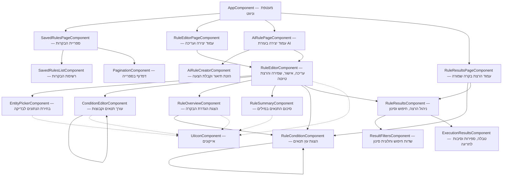

# ‏מפת קומפוננטות ה־UI

‏התרשים מציג את 18 הקומפוננטות בפרויקט. חץ מציין שההורה מציג את הילד ב־HTML שלו. החצים מ־`AppComponent` לעמודים מייצגים הצגה דרך `router-outlet`. חלק מהרכיבים מוצגים רק בהתאם למצב המסך.

## ‏העמודים והאחריות שלהם

| ‏עמוד | ‏כתובת | ‏אחריות |
| --- | --- | --- |
| ‏`SavedRulesPageComponent` | ‏`/rules` | ‏טעינת רשימת בקרות ומטא־דאטה, דפדוף וניווט לעריכה ולהרצה |
| ‏`RuleEditorPageComponent` | ‏`/rules/new`, ‏`/rules/:id/edit` | ‏קריאת המזהה מהכתובת, טעינת מטא־דאטה, אירוח העורך וטיפול ביציאה מהעמוד |
| ‏`AiRulePageComponent` | ‏`/rules/ai/new` | ‏תחילה מציג הזנת תיאור; לאחר קבלת הצעה מציג את העורך לבדיקה ואישור |
| ‏`RuleResultsPageComponent` | ‏`/rules/:id/results` | ‏טעינת הבקרה והמטא־דאטה והצגת פרטיה לצד קומפוננטת התוצאות |

## ‏עורך הבקרה

- ‏`RuleEditorComponent` מנהל את הטיוטה, טעינת הבקרה לעריכה, שינויים, אישור הצעת AI, שמירה והרצת טיוטה.
- ‏`EntityPickerComponent` מציג בחירה עסקית של הנתונים שעליהם תתבצע הבקרה.
- ‏`ConditionEditorComponent` עורך השוואות וקבוצות AND/OR. הוא קורא לעצמו כדי לאפשר קבוצות מקוננות.
- ‏`RuleOverviewComponent` מציג את הגדרת הבקרה במצב קריאה בלבד, באמצעות `RuleConditionComponent`.
- ‏`RuleSummaryComponent` מציג סיכום מילולי לצד העריכה; `RuleConditionComponent` מציג את עץ התנאים גם באישור החלפת סוג הנתונים ובתצוגת הטיוטה שהורצה.

## ‏תוצאות בשני תהליכי ההרצה

‏אותה `RuleResultsComponent` מופיעה ישירות מתחת לעורך ובתוך עמוד הרצת הבקרה השמורה. היא מנהלת עותק של הבקרה, מסננים שהוחלו, שליחת בקשות, ביטול בקשות קודמות, טעינה, תוצאות ושגיאות.

- ‏`ResultFiltersComponent` מחזיק את מה שמקלידים בשדות החיפוש והסינון, ומודיע להורה כשמחילים בחירה חדשה.
- ‏`ExecutionResultsComponent` מקבל תוצאה ומציג את הטבלה, הספירות והסיבות לחריגה. לחיצה על כפתור סינון בכותרת עמודה מודיעה להורה לפתוח את חלונית המסננים.
- ‏בטיוטה מועברת תוצאה שכבר התקבלה, ולכן אין הרצה ראשונית נוספת. בעמוד הרצה רגיל הקומפוננטה מקבלת הגדרה ומבצעת את ההרצה הראשונה.
- ‏בפתיחה מחדש או בהחלפת הקלט המסננים מתאפסים. הרס הקומפוננטה מבטל בקשות פעילות. אין שירות ניהול מצב נפרד לתוצאות.

## ‏קוד משותף שאינו קומפוננטה

‏`RulesApiService`, ‏`MetadataApiService` ו־`AiProposalsApiService` אחראים לתקשורת עם השרת. `RuleLibraryNavigationService` מטפל בחזרה לספרייה לאחר שמירה. `BusinessValuePipe` מעצב ערכים עסקיים לתצוגה. פונקציות עזר משותפות מטפלות במודלי התנאים, תרגום מסננים וסיכום הבקרה.

